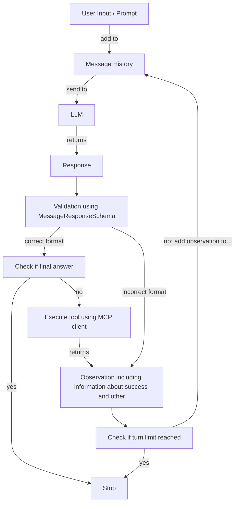

# ReAct Agent (TS)

A minimal demonstration of a [ReAct](https://doi.org/10.48550/arXiv.2210.03629) agent that uses tool calls via MCP to act in a simulated environment.

## Overview

The agent follows the ReAct approach: it alternates between reasoning about the task and calling tools, and it uses the results of those calls to decide on its next step.

The environment it acts in is a deliberately very minimal simulation of a web app builder. It provides only the bare minimum needed to illustrate how tool calls work, so it is not meant to be a realistic or complete builder.

Parts of the implementation are inspired by:

- [mattambrogi/agent-implementation](https://github.com/mattambrogi/agent-implementation)
- [ReAct Agent Pattern (TypeScript)](https://codesociety.net/patterns/agentic/react-agent/typescript/)

## Structure

- `src/agent`: agent logic (ReAct loop, tool call handling, context summary)
- `src/environment`: files that simulate the web app builder environment
- `src/mcp`: factories for MCP server and MCP client including tool definition

## Other Features

### (Automatic) Context Summary:

The entire chat history must be included with every request sent to the LLM. To prevent the context window from becoming overloaded, it is possible to have the chat history summarized (automatically). This summary is generated by the LLM itself and can be triggered manually by calling the `summarize()` method on a `ChatHistory` instance.

For automatic summarization, the number of tokens is estimated for the current chat history using [tokenx](https://github.com/johannschopplich/tokenx). Each time a message is added to the chat history, the system checks whether the estimated number of tokens exceeds a specific percentage of the previously specified context length. If so, the summarization is performed.

## Model

The project was developed and tested with [llama.cpp](https://github.com/ggml-org/llama.cpp) and a quantized Qwen3.8 model: [unsloth/Qwen3.8-27B-GGUF](https://huggingface.co/unsloth/Qwen3.8-27B-GGUF).

## ReAct Loop

